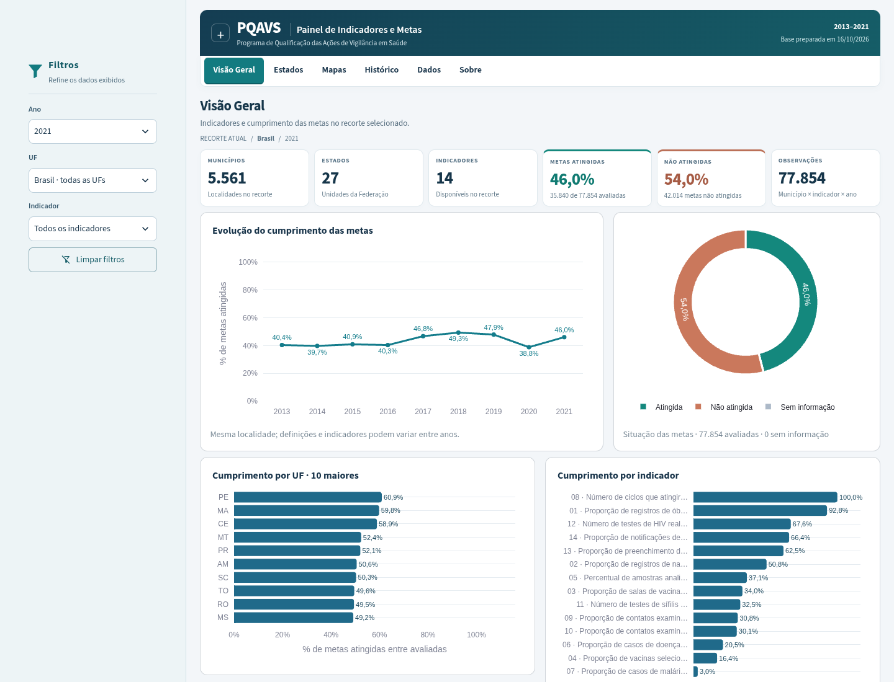

# Painel PQAVS

Painel de Indicadores e Metas do Programa de Qualificação das Ações de Vigilância em Saúde. Python + Streamlit + Pandas + Plotly, com dados locais em Parquet. Sem banco de dados, API própria, Node ou serviços pagos.



## O que está disponível

Seis áreas: **Visão Geral**, **Estados**, **Mapas**, **Histórico**, **Dados** e **Sobre**. As páginas próprias de Municípios, Indicadores e Comparações foram removidas; a granularidade municipal, as definições anuais e as análises temporais permanecem em Mapas, Histórico e Dados. Filtros de ano, UF, município e indicador continuam dependentes. CSV e XLSX exportam somente o recorte filtrado; a tabela tem paginação.

Base fornecida: `Base_Painel.xlsx`, com **50.112 registros município–ano**, **712.708 observações de indicadores**, **5.570 códigos municipais**, **27 UFs**, **2013–2021** e **15 números de indicador distintos**. O conjunto tem 14 indicadores por ano, exceto 2016–2017, com 15. A numeração muda no tempo; números iguais não garantem conceitos iguais.

O Parquet principal ocupa cerca de **7,54 MiB** (7.903.564 bytes na preparação inicial). Os arquivos tratados estão incluídos no repositório: não é preciso converter o Excel para abrir o painel. O Excel original não é versionado.

## Navegação e interface

A navegação principal fica no topo: **Visão Geral · Estados · Mapas · Histórico · Dados · Sobre**. É um `st.radio` horizontal nativo, estilizado pela chave pública `pagina`, sem plugins ou JavaScript da aplicação. O widget mantém navegação por teclado e leitor de tela. CSS `position: sticky` o mantém visível sob a barra do Streamlit durante a rolagem; em celular, os itens rolam horizontalmente dentro da faixa, sem alargar a página.

A sidebar nativa recolhível reúne somente filtros e controles contextuais: ano, UF, município, indicador, período histórico e consulta de dados conforme a página. O botão Limpar filtros restaura o recorte sem trocar de página. As dependências ano → UF → município e disponibilidade do indicador foram preservadas. Cabeçalho, navbar, títulos, espaçamentos e cards usam estilos compactos compartilhados. A Visão Geral apresenta seis cards e dois gráficos lado a lado no desktop; grades respondem à largura útil, inclusive ao recolher a sidebar. Detalhes extensos ficam em expanders. Os gráficos têm rótulos no padrão brasileiro; séries densas restringem rótulos e as análises mantêm tooltips completos. CSV, XLSX, paginação, alcance de metas e cálculos anteriores foram preservados.

### Séries históricas no seletor

Histórico oferece **34 opções conceituais**, sem repetir cada ano como se fosse outro indicador. O agrupador reutiliza `series_key`: descrição normalizada sem número, acentos ou pontuação, mais unidade. Redações diferentes continuam separadas; o número sozinho nunca estabelece equivalência. O rótulo traz todos os números usados e o período (por exemplo, `13/14 · 2013–2021`). A descrição completa aparece abaixo do controle.

A investigação encontrou **63 séries analíticas**: a preparação separa por ano as escalas `Original` não comprovadas, causando a aparência de indicadores repetidos. Essas séries continuam intactas. Depois de escolher um desses conceitos, o controle **Ano da série · escala não comparável** escolhe uma série anual; não unimos resultados de escalas desconhecidas. O conceito dos ciclos da dengue aparece uma vez, mas seus anos continuam separados na análise. O mapa temporal também respeita essa restrição. Catálogo auditável em `docs/series_historicas.json`.

### Controles superiores

O CSS oculta `stToolbarActions`, `stAppDeployButton` e `MainMenu`, preservando o contêiner nativo da toolbar e o botão de abrir a sidebar. Cabeçalho e navbar receberam destaque moderado; a navegação ativa usa fundo institucional e mantém foco/teclado. A sidebar tem título com ícone CSS, fundo integrado e bordas/foco nos controles.

Os seletores de teste do Streamlit são mais legíveis que classes geradas, mas não são uma API pública garantida. A versão está fixada em `requirements.txt`; revalidar ao atualizar. A aplicação não controla barras externas à sua página/iframe, nem a interface de gerenciamento do Community Cloud. O app local foi validado; a URL publicada não foi acessada nesta rodada.

## Estados: desempenho municipal descritivo

A sidebar usa **Ano**, **UF** e **Ordenar indicadores**. O principal gráfico sempre inclui todos os indicadores daquele ano: 14 em 2013–2015 e 2018–2021; 15 em 2016–2017. Não há filtro de indicador capaz de ocultá-los.

A página começa com cards e barras horizontais **100% empilhadas**. Cada barra distribui os registros municipais do indicador em Meta atingida, Meta não atingida e Sem informação. O denominador das três partes é o total de registros do indicador; os percentuais somam 100%. A ordenação padrão é maior percentual de não atingimento; nomes abreviados mantêm o código, e tooltips mostram definição completa, contagens e denominadores.

O perfil municipal calcula `atingidas / (atingidas + não atingidas)` em cada município. Faixas: <30%, 30–<50%, 50–<70%, 70–<90%, ≥90%, além de Sem avaliação. Os quatro patamares mostram a proporção de municípios **com ao menos uma situação conhecida** que alcança ≥30/50/70/90% das situações conhecidas. Municípios sem avaliação ficam explícitos e separados. Esses são perfis **descritivos**, sem pressupor aplicabilidade oficial.

Brasil mostra comparação entre UFs e **heatmap UF × indicador**, com escala fixa 0–100: cada célula usa municípios que atingiram ÷ municípios com situação conhecida, nunca média de resultados numéricos. Uma UF substitui o heatmap por uma comparação com Brasil por indicador. A tabela UF/ano/indicador fica no final, com avaliados, atingiram, não atingiram, sem informação e cumprimento municipal. Em telas estreitas, barras e heatmap mantêm largura legível e rolam dentro de seus painéis.

`src/state_analysis.py` armazena agregações anuais UF×indicador e perfis por ano/UF em `st.cache_data`, com limites e assinatura dos Parquets. Nenhum registro bruto é modificado.

### Ausência, aplicabilidade e incentivo oficial

Na base atual, todas as 712.708 observações têm situação registrada; resultado numérico ausente não implica avaliação ausente. Cada município presente no ano tem 14 ou 15 registros, conforme o catálogo. Os nove municípios ausentes de 2019/2021 não são acrescentados a partir da malha. Em bases incompletas, pares sem registro são contados separadamente, sem criar falhas nem inferir aplicabilidade.

Não há cadastro de aplicabilidade universal/específica, adesão ou regra histórica de incentivo. Portanto, **nenhum incentivo oficial é exibido para 2013–2021**. Sem informação permanece uma terceira situação e não vira meta não atingida. A exclusão de situações desconhecidas nos percentuais descritivos é explícita e não define o denominador oficial do programa.

## Regras metodológicas versionadas

`indicator_rules/historical.json` aponta para as definições anuais da fonte em 2013–2021, sem substituir nomes, metas ou situações. `indicator_rules/2025.json` registra somente a referência estrutural fornecida: 14 indicadores (7 universais/7 específicos), tabela de incentivo e regra de adesão. Seu estado é **reference_only**, não validado para operação, e não contém nomes/classificações individuais inventados.

Referência informada: **Ministério da Saúde — Programa de Qualificação das Ações de Vigilância em Saúde — PQA-VS; cartilha atualizada com indicadores/metas aplicáveis a partir de 2025; Portaria GM/MS nº 6.878/2025**. Não é uma regra retroativa para 2013–2021. A cartilha completa não foi anexada/verificada nesta rodada; a transcrição do pedido sustenta a seção de referência, não um cadastro operacional completo.

| Municípios que alcançam o patamar | Patamar de indicadores | Faixa na referência de 2025 |
|---|---:|---:|
| ≥90% | ≥30% | 25% |
| ≥90% | ≥50% | 50% |
| ≥90% | ≥70% | 75% |
| ≥80% | ≥90% | 100% |

`src/rules.py` resolve configurações pelo período; regras de indicador exigem **ID conceitual e número**, nunca número sozinho. O esquema aceita categoria, meta, fonte e tipos de avaliação `GREATER_EQUAL`, `LESS_EQUAL`, `REDUCTION_FROM_BASELINE`, `MAINTAIN_ZERO` e `COMPOSITE`. Isso prepara metadados futuros, sem substituir as situações oficiais por um cálculo universal `resultado >= meta`.

O cálculo futuro de faixa estadual exige configuração `validated`, fonte, política explícita de ausência, cadastro completo de aplicabilidade (inclusive `false`), universo municipal oficial, um único estado/ano, séries compatíveis e todas as situações necessárias conhecidas. Sem qualquer requisito, retorna ausência de classificação. Os testes exercitam essa API com dados sintéticos; a aplicação histórica não recebe cadastro fictício. Categorias universais/específicas só são mostradas com configuração validada e séries compatíveis. Um cadastro futuro real ainda precisa fornecer aplicabilidade, coorte municipal e metadados completos; a referência distribuída não ativa a classificação.

A regra de adesão de pelo menos 60% dos municípios é documentada em Sobre e permanece distinta de desempenho; não existe indicador de adesão na base.

## Mapas locais

Em **Mapas**, selecione um **ano**, **indicador** e **UF**. A opção Brasil abre o coroplético estadual com cumprimento de 0–100% e ranking das UFs. Uma UF abre seu mapa municipal com situação da meta, tooltip com resultado/meta e ranking do recorte. Na página Estados há um atalho que transfere o recorte para Mapas. Mapas e rankings empilham-se em telas menores.

A camada estadual aplica exatamente `atingiram / (atingiram + não atingiram) × 100` a **um único indicador/ano**, reutilizando as métricas existentes. Municípios sem situação são cinza. Territórios da malha sem observação naquele ano também são cinza, mas o tooltip e a contagem identificam essa ausência; eles não são adicionados à base nem ao denominador. Em 2021, por exemplo, sete territórios do Piauí não têm observação na fonte.

### Evolução territorial

Em **Mapas**, ative **Comparar mapas no tempo** na sidebar. O mapa principal e seu ranking permanecem; abaixo aparece o expander **Evolução territorial**. O seletor próprio aceita **até seis anos**, sem mudar o ano do mapa atual. O padrão escolhe até cinco anos distribuídos igualmente entre o primeiro e o último ano compatível; com nove anos, por exemplo, 2013/2015/2017/2019/2021. Somente anos da `SERIE` exata do indicador atual são elegíveis, incluindo renumeração válida. Escalas originais sem comprovação histórica oferecem somente seu ano; não é inferida equivalência.

Brasil usa mapas por UF com a mesma escala fixa **0–100%** e uma legenda compartilhada. Uma UF usa mapas municipais com as mesmas cores de Atingida/Não atingida/Sem informação em todos os anos. Os tooltips mantêm ano, indicador, dados da meta e identificação territorial; ausências não são imputadas. Combinações vazias mostram uma mensagem. A malha continua estática e simplificada, sem presumir limites históricos.

A grade responde à largura útil: três mapas em desktop amplo, dois em larguras intermediárias e um no celular. A funcionalidade fica desligada inicialmente; fechar o expander apenas recolhe sua apresentação, e desligar a opção na sidebar interrompe o preparo/renderização dos mapas históricos. `st.cache_data` guarda o recorte completo da série/território e suas camadas anuais, com assinatura dos dados e da geometria para invalidação. A malha é lida do cache local uma vez por preparo; não há download nem arquivos geográficos duplicados.

### Origem, códigos e tamanho

Geometrias de origem **IBGE**, redistribuídas pelo espelho público [luizpedone/municipal-brazilian-geodata](https://github.com/luizpedone/municipal-brazilian-geodata), fixado na revisão [`e85ba38c0c7d5acda8d8878099a7f321dddefa33`](https://github.com/luizpedone/municipal-brazilian-geodata/tree/e85ba38c0c7d5acda8d8878099a7f321dddefa33). O espelho inclui um script de coleta da API de malhas do IBGE. A API oficial estava bloqueada pela rede deste ambiente; a obtenção foi feita pelo espelho. A licença MIT do espelho foi preservada em `assets/maps/LICENSE-source.txt`.

| Geometrias otimizadas | Quantidade | Bytes | MB decimais |
|---|---:|---:|---:|
| Brasil por UF | 27 feições / 1 arquivo | 108.572 | 0,109 |
| Municípios separados por UF | 5.570 feições / 27 arquivos | 5.910.364 | 5,910 |
| **Total GeoJSON adicionado** | **28 arquivos** | **6.018.936** | **6,019** |

O total de GeoJSON equivale a **5,74 MiB**. Há ainda **107.761 bytes** de TopoJSON auxiliar de Natural Earth, redistribuído por `world-atlas` 2.0.2, em `static/maps/un/world_110m.json` (integridade SHA-512 do pacote verificada). Somados, os arquivos cartográficos têm **6.126.697 bytes** (aproximadamente 6,13 MB), além de manifestos e licenças. Esse arquivo auxiliar não substitui nem é usado para associar os municípios: as cores e os limites analíticos continuam vindo exclusivamente dos GeoJSONs IBGE. A origem, o hash e a licença auxiliar estão em `static/maps/`. O serviço estático nativo foi habilitado em `.streamlit/config.toml`; somente a UF selecionada é carregada para a análise municipal. O arquivo do Pará tem 296.227 bytes. Geometrias e agregações usam `st.cache_data` com limites de entradas e assinatura do arquivo. As outras páginas não carregam malhas municipais. O Plotly usa coropléticos SVG com `geo.fitbounds="locations"`, autoenquadramento responsivo e camadas globais desativadas. O arquivo TopoJSON auxiliar que o renderizador exige é servido pela própria aplicação, sem depender de CDN. Não há tiles, WebGL ou JavaScript personalizado na aplicação.

**Correspondência: 5.570 de 5.570 municípios da base, 100%; sem correspondência: zero.** O código de sete dígitos da geometria fornece os **seis primeiros dígitos**, comparados como texto ao `COD_MUN` original e à UF. Os prefixos são únicos e a UF corresponde ao seu código oficial. Não foi calculado ou acrescentado dígito municipal, e os Parquets não foram modificados. A cobertura, os hashes, a revisão e o tamanho de cada arquivo estão em `assets/maps/manifest.json`.

A preparação simplificou a geometria com tolerância angular de 0,025° para UFs e 0,006° para municípios, preservando topologia. Os anéis foram orientados no sentido horário externo e anti-horário interno exigido pelo renderizador D3/Plotly, invertendo apenas a ordem dos vértices, sem mudar os limites. As coordenadas foram arredondadas a quatro casas quando válidas, com maior precisão como fallback. Treze geometrias inválidas na origem passaram por reparação topológica de seus componentes poligonais; os identificadores constam no manifesto. Nenhuma geometria foi desenhada ou inventada.

**Limitação cartográfica:** a malha é estática e simplificada. O ano da malha não está declarado nos arquivos do espelho; não se presume que ela reproduza limites municipais em cada ano de 2013–2021. Não usar para medir áreas ou definir limites legais. A metodologia dos dados de saúde continua a mesma.

### Repreparar as geometrias (opcional)

Isso não faz parte da instalação ou execução normal. Os arquivos necessários já estão versionados. Para reproduzir a preparação, com Internet e dependências opcionais:

```bash
python -m pip install -r requirements-maps.txt
python scripts/preparar_mapas.py --saida assets/maps_novos
```

Confira o manifesto, a cobertura, a licença e os testes antes de substituir `assets/maps/` pelo conjunto validado. Não execute conversões concorrentes. Atualize todos os arquivos geográficos e o manifesto juntos. Shapely é usado **somente nessa preparação**; não foi adicionado ao `requirements.txt` do Community Cloud.

## Executar localmente

**Python 3.12 recomendado e validado.** É necessário acesso ao PyPI apenas para instalar dependências. O painel consulta exclusivamente dados locais, sem credenciais ou chamadas externas para exibir análises.

### Windows: dois cliques

Execute `INICIAR_PAINEL.bat`. Ele verifica o Python, cria `.venv`, instala as dependências quando necessário, verifica a instalação e inicia o Streamlit com abertura do navegador. A primeira instalação exige Internet. O BAT foi revisado, mas não executado em uma máquina Windows nesta entrega.

### Windows: manual (Prompt de Comando)

```bat
python -m venv .venv
.venv\Scripts\activate
python -m pip install -r requirements.txt
streamlit run app.py
```

No PowerShell, a ativação é `.venv\Scripts\Activate.ps1`. Se a política local impedir ativação, use diretamente `.venv\Scripts\python.exe -m streamlit run app.py`.

### Linux / macOS

```bash
python3 -m venv .venv
source .venv/bin/activate
python -m pip install -r requirements.txt
streamlit run app.py
```

Execute os comandos na raiz do repositório. Interrompa com `Ctrl+C`. Em ambientes remotos, use o encaminhamento de portas oferecido pela plataforma; o onboarding não oferece preview público de localhost.

## Atualizar dados

1. Coloque o novo `Base_Painel.xlsx` na raiz do projeto, mantendo o arquivo original como cópia de segurança. Ele está no `.gitignore`.
2. Com o ambiente virtual ativo, execute:

   ```bash
   python scripts/preparar_dados.py Base_Painel.xlsx
   ```

3. O script lê todas as abas com as dimensões obrigatórias, identifica dinamicamente os campos `IND_XX_*`, limpa ausentes e gera:

   - `data/base_pqavs.parquet`: uma linha por município × indicador × ano;
   - `data/indicadores.parquet`: dicionário por indicador e ano, unidade, escala e alertas;
   - `data/metadata.json`: hash SHA-256 da fonte, data de preparação, contagens e auditoria de todas as colunas.

4. Confira os totais, alertas e o tamanho dos arquivos. Execute os testes. Atualize os valores de referência dos testes de integração **somente após conferir a nova base**. `docs/auditoria_excel.json` descreve o arquivo inicial e não é atualizado automaticamente; a auditoria atual sempre está em `data/metadata.json`.
5. Faça commit dos **três arquivos em `data/`** e envie ao GitHub na branch usada no deploy. Mantenha-os na mesma atualização. O Streamlit Community Cloud acompanha o repositório e atualiza a aplicação; se necessário, reinicie-a no painel de gerenciamento.

A leitura usa `st.cache_data` com assinatura dos arquivos (nome, modificação e tamanho), invalidada ao trocar os dados. A conversão é feita fora do ciclo de interação. O Parquet usa compressão Zstandard e categorias para textos repetidos. O app mantém uma cópia em cache da base tratada; não lê o Excel a cada filtro. Exportações só são preparadas ao solicitar, para poupar memória.

O script valida as novas saídas antes da substituição dos arquivos. Se ele falhar durante a leitura ou transformação, os Parquets anteriores permanecem. Não execute atualizações concorrentes no mesmo diretório. `--saida caminho` permite preparar e conferir em outro diretório antes de substituir o conjunto.

## Metodologia e cuidados

**Cumprimento = atingidas / (atingidas + não atingidas) × 100**. Sem informação é apresentado separadamente e não entra no denominador. Um indicador/ano representa o percentual de municípios que atingiu a meta; com vários indicadores, a unidade passa a ser o par município–indicador. O painel não interpreta esse percentual como municípios que atingiram todas as metas.

- `ALCANCE_META` válido (0/1) tem prioridade; o fallback aceita apenas `META` com “Sim”/“Não”. Zero isolado no campo `META` não é “Não”.
- Foram encontradas **4.784 divergências**, todas no indicador 8 de 2013: `ALCANCE_META=1`, `META=Não`. A origem da divergência não está documentada na planilha. A prioridade é explícita, e ambos os campos mais o sinalizador `CONFLITO_META` estão disponíveis para auditoria/exportação.
- Há **30.261 resultados numéricos ausentes**, embora uma situação da meta possa estar explicitamente registrada. Não se deduz sucesso a partir da ausência de casos ou de denominador zero.
- Códigos municipais são texto. Não criamos o sétimo dígito a partir dos códigos de seis dígitos fornecidos.
- Resultados originais permanecem no Parquet e nas exportações. Uma proporção só é exibida em % quando a definição e a comparação entre resultado e NUM/DEN sustentam a conversão. Outras escalas permanecem originais, com indicação explícita. Nenhuma conversão usa apenas o máximo observado ou o fato de um valor ser menor que 1.
- Não usamos média simples dos resultados municipais como resultado Brasil/UF. Agregações de resultado por soma de numeradores/denominadores não são publicadas sem comprovação de compatibilidade estatística. As comparações de UF usam cumprimento.
- Séries históricas ligam definições textuais iguais após remover número, acentos e pontuação, na mesma unidade validada. Isso permite mudanças de numeração sem unir conceitos diferentes. Por segurança, redações distintas e escalas originais não comprovadas são separadas; estas últimas ficam isoladas por ano. O alcance da série é mostrado no seletor.
- A linha de meta numérica aparece somente para regras percentuais simples com unidade comprovada. Ela não substitui a classificação oficial da fonte.
- Diferenças de cumprimento são expressas em **pontos percentuais**; a variação relativa é identificada separadamente. Alterações do conjunto de indicadores e da cobertura territorial limitam a comparação histórica.

### Limitações da fonte

O dicionário cita 2022, mas **não há dados de observações de 2022**. O indicador 15 só possui observações em 2016–2017; as demais colunas de preenchimento desse indicador foram descartadas. O indicador 8 de 2020–2021 não tem resultado numérico, mas possui alcance informado. Em 2013 e de 2018 em diante, o indicador 6 combina descrição de proporção com rótulo de meta de semanas: a divergência fica sinalizada, sem correção presumida. Valores extremos e denominadores zero são preservados. Em 2019 e 2021 há 5.561 municípios; nos demais anos, 5.570. Não foi imputada a ausência dos nove registros.

A data de atualização da fonte e a procedência institucional do arquivo não foram informadas. O cabeçalho informa a **data de preparação**, e não uma data presumida de atualização dos dados. Mais detalhes em [análise da base](docs/ANALISE_BASE.md) e na página Sobre / Metodologia.

## Estrutura

```text
app.py                       # Entrada e navegação entre seis páginas
src/
  data.py                    # Leitura, limpeza, escalas, dicionário e cache
  filters.py                 # Filtros dependentes e séries históricas
  metrics.py                 # Cumprimento, rankings e variação histórica
  charts.py                  # Plotly, mapas, rótulos e tooltips
  navigation.py              # Barra superior com widget nativo
  geography.py               # GeoJSON local e associação territorial
  state_analysis.py          # Distribuições e perfis descritivos em cache
  rules.py                   # Registro temporal e bloqueios de incentivo oficial
  historical.py              # Conceitos do seletor e anos compatíveis
  territorial_history.py     # Recortes e camadas temporais em cache
  styles.py                  # Identidade visual e cards
  views.py                   # Seis páginas e exportações
  utils.py                   # Formatação brasileira
scripts/
  preparar_dados.py           # Excel → Parquet e auditoria
  preparar_mapas.py           # Obter e simplificar mapas (opcional)
  medir_desempenho.py         # Medir reruns no AppTest
  iniciar_local.py            # Auxiliar do BAT
assets/                      # CSS, ícone e mapas locais
static/maps/                 # TopoJSON auxiliar, licença e origem
.streamlit/config.toml       # Tema claro e configurações
requirements.txt             # Dependências de execução com versões fixadas
requirements-dev.txt         # pytest e Playwright
INICIAR_PAINEL.bat            # Inicialização Windows
indicator_rules/             # Referências históricas e de 2025, separadas por período
data/                       # Parquets e metadados versionados
docs/                       # Auditoria, validação e screenshots
tests/                      # Testes de dados e páginas
```

As seis páginas são funções organizadas em `src/views.py`, com navegação única em `app.py`. Isso permite filtros e estilo compartilhados sem repetir código em seis scripts. Não há um backend separado.

## Streamlit Community Cloud: manter o mesmo aplicativo

Para a aplicação já publicada, faça push na `main` do mesmo repositório e acompanhe a atualização no Community Cloud. Preserve a configuração de entrypoint `app.py` e a URL existente. Para uma instalação inicial, as etapas são:

1. Envie o projeto, os três arquivos de `data/` e os mapas de `assets/maps/` ao GitHub.
2. Acesse [share.streamlit.io](https://share.streamlit.io) e conecte sua conta GitHub.
3. Selecione o repositório **thiagojk/PAINEL-STREAMLIT**.
4. Selecione a branch **main** e o arquivo **app.py**.
5. Nas opções avançadas, selecione **Python 3.12**.
6. Faça o deploy.

O app não exige banco, Docker, segredos, servidor externo ou plano pago. O Parquet principal tem menos de 8 MiB, abaixo do limite de 100 MiB por arquivo Git comum do GitHub. Os mapas usam GeoJSON local e projeção SVG nativa do Plotly, sem token, tiles externos ou dependências geoespaciais de execução. XLSX fica limitado a recortes de 100 mil linhas para reduzir consumo de memória; CSV permanece disponível. O dashboard já está publicado pelo proprietário. Esta atualização mantém o mesmo `app.py`, as mesmas dependências de execução e o mesmo repositório: enviar à `main` permite atualizar o aplicativo existente sem criar outro ou alterar sua URL. O estado remoto do deploy não foi verificado nesta máquina.

## Testes

```bash
python -m pip install -r requirements-dev.txt
python -m pytest -q
python -m compileall .
python -m pip check
```

Os testes cobrem limpeza, detecção de novos indicadores, códigos com zeros iniciais, status e conflitos, filtros, conversão Excel/Parquet, repetibilidade, agregações, rankings, séries/renumeração e as seis páginas via `streamlit.testing.v1.AppTest`. Os testes da base real verificam contagens específicas do arquivo inicial; atualizações legítimas exigem revisar essas expectativas.

A validação em navegador Chromium cobre navegação, filtros, trajetória, comparação, downloads CSV/XLSX e tamanhos de tela. Veja [validação](docs/VALIDACAO.md) e [screenshots](docs/screenshots/).

Para repetir a validação de navegador, inicie o app na porta 8502 e, em outro terminal:

```bash
python -m playwright install chromium
python scripts/validar_interface.py
```

Se já houver Chromium instalado, use `python scripts/validar_interface.py --chromium /caminho/do/chromium` e dispense o download. A porta pode ser alterada com `--url`. As capturas são gravadas em `docs/screenshots/` e o relatório em `docs/validacao_navegador.json`.

Para repetir a medição de reruns (separada da renderização real de navegador):

```bash
python scripts/medir_desempenho.py
```

A comparação com a versão anterior está em `docs/desempenho_antes.json` e `docs/desempenho_depois.json`; os limites da medição estão em `docs/VALIDACAO.md`.

A validação adicional de conceitos e evolução territorial pode ser repetida com `python scripts/validar_evolucao.py --url http://127.0.0.1:8501/ --chromium /caminho/do/chromium`. O relatório fica em `docs/validacao_evolucao.json`.

A validação numérica de Estados pode ser repetida com `python scripts/validar_estados.py --url http://127.0.0.1:8501/ --chromium /caminho/do/chromium`. O relatório `docs/validacao_estados.json` registra nove recortes, três barras conferidas contra o Parquet e três células do heatmap.
